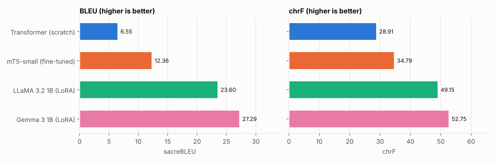
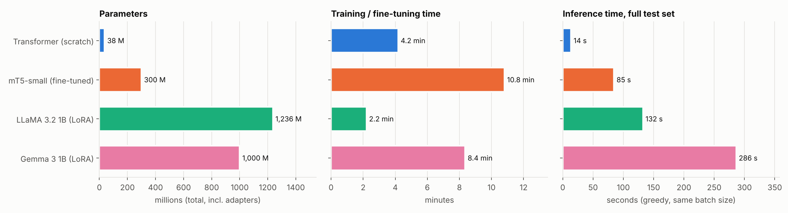
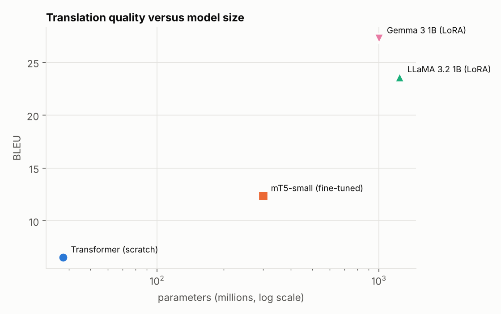
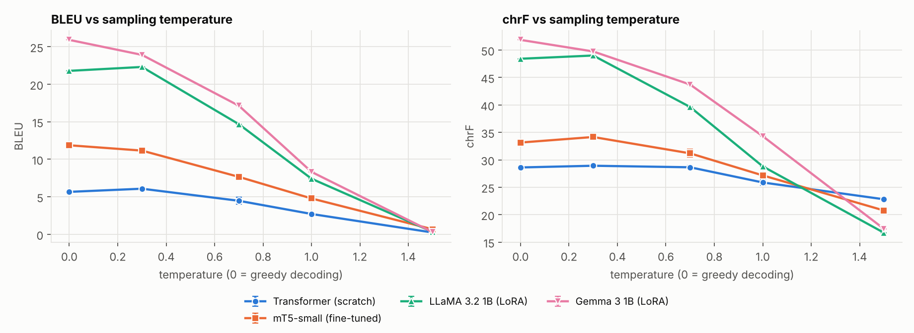

# bonjour-bench: Encoder-Decoder versus Decoder-Only Machine Translation (English to French)

**Course:** Foundations of Generative AI (ICT4403), Assignment 3
**Student:** Nandini Neelesh (Registration No. 230911098), Manipal Institute of Technology
**Repository:** https://github.com/nandini-neelesh/bonjour-bench

> **Status of this document.** Sections 1 to 5 describe the experimental design and are complete. The result
> tables in Section 6 and the discussion in Sections 7 to 10 are filled in after the experiments are run
> (blocks marked `PENDING`).

---

## 1. Problem Statement and Objective

Machine translation is a conditional text-generation task: given an English sentence, an autoregressive model
must generate its French translation token by token. Two architectural families dominate current practice:
**encoder-decoder** models, which encode the whole source sentence and then decode the target, and
**decoder-only** models, which treat translation as continuation of a prompt.

The objective of this project is to compare the two families on one language pair and one test set, under
comparable decoding settings, along three axes:

1. **Translation quality**, measured with BLEU and chrF.
2. **Computational requirements**: training or fine-tuning time, inference time and number of parameters.
3. **Responsible use**: bias, hallucination, cultural misrepresentation and handling of sensitive content,
   examined on the generated translations, together with mitigation measures.

Four systems are built: a basic Transformer trained from scratch, a fine-tuned mT5, and LLaMA and Gemma adapted
by LoRA fine-tuning and by few-shot prompting.

## 2. Dataset Description and Source

| Item | Value |
|---|---|
| Dataset | OPUS-100 (English-centric multilingual parallel corpus) |
| Language pair | English (source) to French (target) |
| Source link | https://huggingface.co/datasets/Helsinki-NLP/opus-100 (configuration `en-fr`) |
| Original project | https://opus.nlpl.eu/opus-100.php |
| Reference | Zhang, Williams, Titov and Sennrich (2020), *Improving Massively Multilingual Neural Machine Translation and Zero-Shot Translation*, ACL 2020 |
| Official sizes (en-fr) | 1,000,000 training, 2,000 validation, 2,000 test sentence pairs |

OPUS-100 is sampled from the OPUS collection of web-crawled and subtitle/legal/software parallel data, so it covers
many domains and contains noise. The usage terms of the underlying corpora are described on the dataset card.

**Preprocessing** (`bonjour/data.py`, deterministic with seed 42):

- Unicode NFC normalisation, removal of control characters, whitespace collapsing.
- Removal of empty pairs, pairs whose two sides are identical, pairs shorter than 1 or longer than 80 words,
  pairs whose character-length ratio is outside 1:2.5, pairs with fewer than 50% alphabetic characters, and exact
  duplicates.
- **Leakage control:** every training pair whose English or French side also occurs in the validation or test
  set is removed from the training pool.
- **Splits used:** 100,000 training pairs sampled from the cleaned training pool, 1,000 validation pairs and
  2,000 test pairs sampled from the cleaned official validation and test sets. All four systems are evaluated
  on the identical test file. The validation and test files, their statistics and SHA-256 checksums are committed
  in `data/processed/`; the training file is regenerated deterministically by `python -m bonjour.data`.

Dataset statistics and the length distribution are written to `data/processed/data_stats.json` and
`results/summary/data_lengths.png`.

<!-- DATA_STATS:START -->
PENDING: dataset statistics (sizes before and after cleaning, number of removed pairs per rule, mean sentence length).
<!-- DATA_STATS:END -->

## 3. Models Implemented

| System | Family | Pre-trained | Adaptation | Checkpoint |
|---|---|---|---|---|
| Basic Transformer | encoder-decoder | no | trained from scratch | `bonjour/models/transformer_scratch.py` |
| mT5-small | encoder-decoder | yes (mC4, 101 languages) | full fine-tuning | `google/mt5-small` |
| LLaMA 3.2 1B | decoder-only | yes | LoRA fine-tuning, and 5-shot prompting | `meta-llama/Llama-3.2-1B` |
| Gemma 3 1B | decoder-only | yes | LoRA fine-tuning, and 5-shot prompting | `google/gemma-3-1b-pt` |

**Basic Transformer.** Implemented from first principles in PyTorch: multi-head attention, position-wise
feed-forward layers, sinusoidal positions, pre-layer-normalisation, 4 encoder and 4 decoder layers, model
dimension 512, 8 heads, feed-forward dimension 2048, dropout 0.2, shared source/target/output embeddings and a joint
16,000-token SentencePiece BPE vocabulary learned on the training data. It is trained with label smoothing (0.1),
AdamW, linear warm-up followed by inverse-square-root decay, early stopping on validation loss, and
mixed precision. Attention uses a key/value cache during decoding, verified against full teacher-forced
decoding in `tests/test_units.py`.

**mT5-small.** The pre-trained sequence-to-sequence model is fully fine-tuned with the prefix
`translate English to French:`, the Adafactor optimiser and a constant learning rate of 1e-3, in fp32 (mT5 is
numerically unstable in fp16).

**LLaMA 3.2 1B and Gemma 3 1B.** Both are *base* (not instruction-tuned) checkpoints, used with the prompt

```
Translate the following sentence from English to French.

English: <source>
French: <translation>
```

- *LoRA fine-tuning:* low-rank adapters (rank 16, alpha 32, dropout 0.05) on all attention and MLP projections;
  the loss is computed on the translation tokens only; the adapters are merged into the base weights before
  inference, so inference cost equals that of the base model.
- *Few-shot prompting:* five fixed, seeded training examples are placed before every query; no weights change.

## 4. Repository Structure

```
bonjour-bench/
  bonjour/                   Python package (all logic)
    config.py                  paths, split sizes, hyper-parameters
    data.py                    download, cleaning, leakage control, splits
    models/                    transformer_scratch.py, mt5.py, causal_lm.py (LLaMA and Gemma)
    run.py                     train/adapt, translate, score, temperature sweep, ethics probes
    metrics.py                 sacreBLEU BLEU and chrF, output diagnostics
    aggregate.py               tables, charts and README result blocks
  notebooks/                 Kaggle runner notebooks 00-04 (thin wrappers around the package)
  data/processed/            val.jsonl, test.jsonl, statistics, checksums (train.jsonl is regenerated)
  data/probes/               hand-written ethics probe sentences
  results/<run>/             metrics.json, test_translations.jsonl, temperature_sweep.json, probe_translations.jsonl
  results/summary/           result tables and charts
  tests/                     unit tests and tiny-model smoke tests
  scripts/                   notebook generator, results zipper
```

## 5. Execution Steps and Dependencies

**Dependencies.** Python 3.10+, PyTorch 2.2+, `transformers` 4.50+, `datasets`, `sacrebleu`, `sentencepiece`,
`peft`, `accelerate`, `matplotlib` (see `requirements.txt`). LLaMA and Gemma are gated on Hugging Face: accept
their licences on the model pages and create a read token.

**Hardware used.** Kaggle notebook, one NVIDIA T4 GPU (16 GB). <!-- HARDWARE: confirm GPU name from results/*/metrics.json -->

**Steps.**

```bash
git clone https://github.com/nandini-neelesh/bonjour-bench.git && cd bonjour-bench
pip install -r requirements.txt            # on Kaggle: pip install -r requirements-kaggle.txt
export HF_TOKEN=<your read token>          # Kaggle: add as a Secret named HF_TOKEN

python -m bonjour.data                                   # 1. build the splits
python -m bonjour.run --model transformer                # 2. Transformer from scratch
python -m bonjour.run --model mt5                        # 3. mT5-small
python -m bonjour.run --model llama --adapt fewshot      # 4a. LLaMA, few-shot
python -m bonjour.run --model llama --adapt lora         # 4b. LLaMA, LoRA
python -m bonjour.run --model gemma --adapt fewshot      # 5a. Gemma, few-shot
python -m bonjour.run --model gemma --adapt lora         # 5b. Gemma, LoRA
python -m bonjour.aggregate                              # 6. tables, charts, README blocks
```

Add `--smoke` to any `run` command for a few-minute end-to-end check on a tiny sample. Each run writes
its outputs to `results/<run>/`. The notebooks in `notebooks/` execute the same commands on Kaggle.
Run `python -m pytest tests -q` to execute the unit tests.

**Evaluation protocol (identical for all systems).** The same 2,000 test sentences; greedy decoding; at most 128
new tokens; batch size 32 with length-sorted batching; sacreBLEU 13a-tokenised corpus BLEU and chrF with the
signatures stored in each `metrics.json`; inference time is the wall-clock time for the full test set after a
warm-up batch, with CUDA synchronisation; parameter counts are of the deployed model.

---

## 6. Results

<!-- RESULTS_TABLE:START -->
PENDING: results table.
<!-- RESULTS_TABLE:END -->

Output diagnostics:

<!-- DIAGNOSTICS_TABLE:START -->
PENDING: diagnostics table.
<!-- DIAGNOSTICS_TABLE:END -->





Sample translations for every system are stored in `results/<run>/test_translations.jsonl`.

## 7. Model Comparison and Evaluation

<!-- ANALYSIS:START -->
PENDING: comparison of encoder-decoder and decoder-only systems with respect to model size, pre-training,
tokenisation and adaptation method, based on the results above.
<!-- ANALYSIS:END -->

## 8. Sampling-Temperature Analysis

Each system is decoded on a fixed random subset of 300 test sentences with greedy decoding and with temperature
sampling at T = 0.3, 0.7, 1.0 and 1.5 (pure sampling: top-k and top-p disabled), three random seeds per
temperature. Tables give the mean and standard deviation over seeds.

<!-- TEMPERATURE_TABLE:START -->
PENDING: temperature tables.
<!-- TEMPERATURE_TABLE:END -->



<!-- TEMPERATURE_ANALYSIS:START -->
PENDING: interpretation of the temperature results.
<!-- TEMPERATURE_ANALYSIS:END -->

## 9. Responsible and Ethical AI Analysis

**Method.** A set of 46 probe sentences was written by hand (`data/probes/ethics_probes.jsonl`) in six categories:
gender bias (10), formality register (4), idioms (8), culture and religion (6), sensitive content (7) and
hallucination triggers (11). Every system translated all probes with greedy decoding; the outputs are collected
side by side in `results/summary/probes_side_by_side.md`.

<!-- ETHICS:START -->
PENDING: findings per concern (bias, hallucinated information, cultural misrepresentation, sensitive content)
with examples from the probe outputs, and recommended mitigation measures.
<!-- ETHICS:END -->

## 10. Conclusion

<!-- CONCLUSION:START -->
PENDING: best-performing model and the trade-offs observed.
<!-- CONCLUSION:END -->

## Limitations

- Each system was trained once (single training seed); differences of a few tenths of a BLEU point are not
  reliable.
- The training subset is 100,000 sentence pairs. LoRA training for the decoder-only models used a subset of the
  same pool (see `bonjour/config.py` and `metrics.json`), so training times are not like-for-like.
- OPUS-100 contains noisy and domain-mixed sentences; absolute scores are lower than on curated benchmarks.
- Inference time depends on the GPU, batch size and library implementation; the Transformer uses a hand-written
  decoder with a key/value cache, the other systems use Hugging Face `generate`.
- The ethics probes are a small, hand-written sample; they illustrate risks but do not measure their prevalence.
